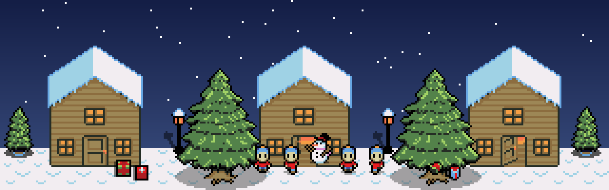
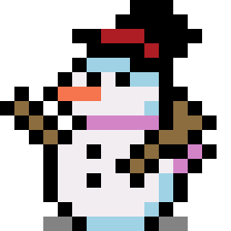

<div align="center">



# 🎄 Christmas Quest: Save Christmas! 🎅

### *A 2D multiplayer co-op RPG for the browser*


❄️ ❄️ ❄️ ❄️ ❄️ ❄️ ❄️ ❄️ ❄️ ❄️ ❄️ ❄️

</div>

## 📖 Story

The **Ice King** has stolen every Christmas present in town and hidden them deep inside his frozen cave.

Your team arrives in a snowy village and meets five NPCs who each lost something precious. Explore, talk to the villagers, journey to the cave together, defeat the Ice King in a co-op boss fight, and **bring the presents home** to save Christmas!

## ✨ Features

| | Feature |
|---|---|
| 🌐 | Real-time multiplayer for **2–6 players** |
| 🧙 | Four playable classes with character selection |
| 🕹️ | WASD movement with synced players |
| 💬 | NPC dialogue and quests |
| 🎁 | Five collectible Christmas presents |
| ❄️ | Co-op boss fight against the Ice King |
| ❤️ | Basic health and damage system |
| 🗨️ | In-game chat *(maybe)* |

## 🗺️ World

- **🏘️ Christmas Town** – a small snowy village with 5–10 buildings, five quest NPCs and the player spawn.
- **🧊 Ice Cave** – outside the town. Home of the Ice King and the stolen presents.

## 🦸 Characters

### Playable classes

| Class | Role |
|---|---|
| ⚔️ **Warrior** | Strong melee attacks, high health |
| 🔮 **Mage** | Magic attacks |
| 🏹 **Archer** | Ranged attacker |
| 💚 **Healer** | Restores teammates' health |

### NPCs

<div align="center"></div>


| NPC | Quest |
|---|---|
| 🎅 **Santa** | Gives the main quest |
| 🧝 **Elf** | Lost his gift |
| 🧸 **Toy Maker** | Needs his stolen presents back |
| ⛄ **Snowman** | Wants his magical snow crystal back |
| 🦌 **Reindeer Keeper** | Needs a special gift for his reindeer |

### 👑 Boss

**Ice King** – the only enemy in the game. He stole everything and waits in the cave.

## 🛠️ Tech Stack

| Layer | Technology |
|---|---|
| Game engine | [Phaser 3](https://phaser.io/) |
| Client | TypeScript, Vite, HTML, CSS |
| Gateway and services | Node.js, TypeScript |
| Browser connection | WebSocket ([Socket.IO](https://socket.io/)) |
| Event broker | [Redpanda](https://redpanda.com/) (Kafka-compatible) |

## 🚀 Getting Started

> The project is still in planning. These commands will apply once the code is scaffolded.

```bash
git clone https://github.com/omertaasci/team2-game.git
cd team2-game
npm install
npm run dev
```

Then open the printed local URL in several browser tabs to play together.

## 🗂️ Planned Structure

```
team2-game/
├── assets/      # Sprites, tilesets and UI art
├── client/      # Phaser 3 game
├── gateway/     # WebSocket <-> event broker
├── services/    # Event consumers (lobby, quest, combat, leaderboard, ...)
├── shared/      # Command and event types shared by all parts
├── concept.md        # Game concept
├── game_events.md    # Event list (producers, consumers, payloads)
└── tech_design.md    # Technical design
```

## 🧭 Roadmap

- [ ] Project setup (Vite, TypeScript, Node server)
- [ ] Multiplayer movement in the snowy town
- [ ] NPC dialogue and quest tracking
- [ ] Ice Cave scene
- [ ] Ice King boss fight (shared health, server-authoritative)
- [ ] Class abilities
- [ ] Return presents and finish the game
- [ ] In-game chat *(optional)*

## 🎨 Assets

- 2D Pixel Dungeon Asset Pack v2.0
- Christmas Village Asset Pack
- Enemy Animations Set

Please check each pack's license before publishing the game.

## 📚 Documentation

- [Concept](concept.md)
- [Game events](game_events.md)
- [Technical design](tech_design.md)

## 👥 Team

**Team 2**

| Member | GitHub |
|---|---|
| Ömer | [@omertaasci](https://github.com/omertaasci) |
| Manvi | [@manvibhatt1137-glitch](https://github.com/manvibhatt1137-glitch) |
| _add the remaining members_ | |

<div align="center">

❄️ *Happy holidays and happy coding!* 🎄

</div>
