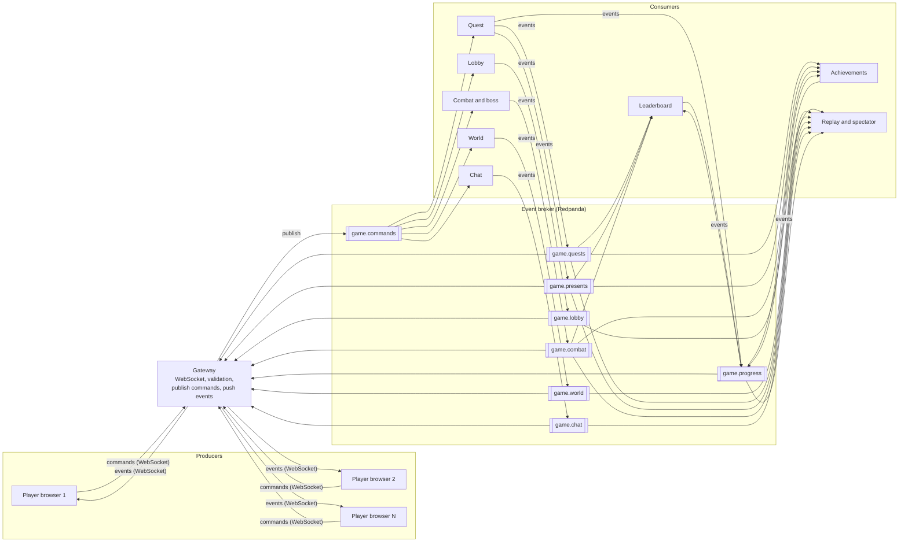

# Technical Design

## 1. Idea

The game is an **event-driven system**. Players send **commands**. Services decide what happened and publish **events** to an **event broker** (Redpanda, Kafka-compatible). Independent **consumers** react to those events. See `game_events.md` for every command, event and topic.

## 2. Stack

| Layer | Technology | Why |
|---|---|---|
| Game client | Phaser 3 + Vite + TypeScript | Tilemaps, animation and input built in |
| Gateway | Node.js + WebSocket (Socket.IO) | Connects browsers to the broker |
| Event broker | Redpanda (Kafka API), shared team server | Durable topics, many independent consumers |
| Services (consumers) | Node.js + TypeScript + `kafkajs` | One process per consumer |
| Shared | TypeScript types | One definition of every command and event |

## 3. Architecture



Text version:

```
Producers            Gateway            Broker (Redpanda)           Consumers
---------            -------            -----------------           ---------
Browser 1  --cmd-->                     game.commands  ----------->  Lobby, World, Quest,
Browser 2  --cmd-->  validate, publish  game.lobby     <-- events -- Combat, Chat
Browser N  --cmd-->  push events        game.world     <-- events --
                     to clients <-----  game.quests    ----------->  Leaderboard, Achievements,
                                        game.presents                Replay / spectator
                                        game.combat
                                        game.chat
                                        game.progress
```

## 4. Components

| Component | Job | Reads | Writes |
|---|---|---|---|
| **Client** | Renders the game, sends commands, applies events | Events from the gateway | Commands |
| **Gateway** | WebSocket server. Authenticates the connection, validates command shape, adds `roomId` and `playerId`, publishes commands. Pushes events to the room's clients. | All event topics | `game.commands` |
| **Lobby** | Rooms, players, class choice, game start | `game.commands` | `game.lobby` |
| **World** | Movement rules, collisions, scenes | `game.commands` | `game.world` |
| **Quest** | NPC dialogue, quests, presents, ending | `game.commands`, `game.combat` | `game.quests`, `game.presents`, `game.progress` |
| **Combat and boss** | Damage, healing, Ice King AI | `game.commands`, `game.lobby`, `game.world` | `game.combat` |
| **Chat** | Chat messages (optional) | `game.commands` | `game.chat` |
| **Leaderboard** | Scores per player | `game.quests`, `game.presents`, `game.combat`, `game.progress` | `game.progress` |
| **Achievements** | Unlocks achievements | `game.quests`, `game.presents`, `game.combat`, `game.progress` | `game.progress` |
| **Replay and spectator** | Stores all events, lets a viewer watch or replay a game | All topics | Its own store |

### Consumer owners

Each team member owns at least one consumer.

| Consumer | Owner |
|---|---|
| Lobby, Gateway | Ömer |
| Quest | _to assign_ |
| Combat and boss | _to assign_ |
| Leaderboard, Achievements | _to assign_ |
| World, Chat, Replay | _to assign_ |

## 5. Message flow

1. A browser sends a **command** over WebSocket.
2. The gateway validates it and publishes it to `game.commands` (key `roomId`).
3. The owning consumer reads it, applies the game rules and publishes one or more **events**.
4. The gateway reads the events and pushes them to the clients in that room.
5. Other consumers (leaderboard, achievements, replay) read the same events in their own consumer groups.

## 6. State

There is no shared database. Each consumer rebuilds its own state from the events it reads.

| Consumer | Keeps in memory |
|---|---|
| Lobby | Rooms, players, classes |
| World | Positions, current scene per player |
| Quest | Quest status, present locations |
| Combat | Player HP, boss HP and phase |
| Leaderboard | Scores |
| Replay | Full event log per room |

On restart, a consumer replays its topics from the start (or from a snapshot) to rebuild its state.

## 7. Broker settings

- **Partitions:** a few per topic. The key is `roomId`, so events of one room stay in order.
- **Consumer groups:** one per service (for example `quest-service`).
- **Retention:** short for `game.commands` and `game.world`, long for `game.progress` and replay data.
- **Delivery:** at-least-once. Consumers are idempotent (they ignore an envelope `id` they already handled).
- **Access:** the broker runs on the shared team server. Broker address and credentials come from environment variables and are never committed.

## 8. Latency

A command goes browser -> gateway -> broker -> service -> broker -> gateway -> browser. With a nearby broker this should stay well under 100 ms, which is fine for a slow co-op RPG.

Movement is the busiest stream. To keep it smooth:
- The client moves its own player immediately and corrects it if `move_rejected` arrives.
- Other players are interpolated between `player_moved` events.
- The World consumer batches positions (about 20 per second).

## 9. Folder structure

```
team2-game/
├── assets/
├── client/            Phaser game
├── gateway/           WebSocket <-> broker
├── services/
│   ├── lobby/
│   ├── world/
│   ├── quest/
│   ├── combat/
│   ├── chat/
│   ├── leaderboard/
│   ├── achievements/
│   └── replay/
├── shared/            command and event types, envelope, topic names
├── docker-compose.yml local Redpanda for development
├── concept.md
├── game_events.md
└── tech_design.md
```

## 10. Scenes and assets

- **Town:** Christmas village tilemap, five NPCs, decorative houses.
- **Cave:** dungeon tileset, Ice King arena and the five presents.
- **Art:** Christmas Village pack (town), 2D Pixel Dungeon pack (cave), Enemy Animations Set (Ice King, recolored). Check licenses before publishing.

## 11. Running

```bash
docker compose up -d redpanda   # local broker (or use the shared team broker)
npm install
npm run dev                     # client, gateway and all services
```

## 12. Testing

- Unit tests per consumer: feed it events and check the events it publishes.
- A script that sends commands from fake clients and checks the resulting events.
- Open several browser tabs to test multiplayer by hand.

## 13. Risks

| Risk | Mitigation |
|---|---|
| Broker latency makes movement feel slow | Client-side prediction, interpolation, batching |
| Duplicate events | Idempotent consumers using the envelope `id` |
| Services drift apart on message format | One shared `shared/` package with types |
| Missing character art | Recolor existing sprites, use class stats instead of unique animations |
| Scope creep | Chat and extra abilities are optional and come last |
