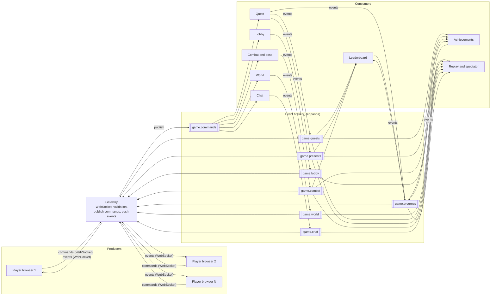

# Technical Design

## 1. Idea

The game is an **event-driven system**. Players send **commands**. Services decide what happened and publish **events** to an **event broker** (Redpanda, Kafka-compatible). Independent **consumers** react to those events. See `game_events.md` for every command, event and topic.

## 2. Stack

| Layer | Technology | Why |
|---|---|---|
| Game client | Phaser 3 + Vite + TypeScript | Tilemaps, animation and input built in |
| Gateway | Node.js + WebSocket (Socket.IO) | Connects browsers to the broker |
| Event broker | Redpanda (Kafka API), shared team server | Durable topics, many independent consumers |
| Services (consumers) | Node.js + TypeScript, Redpanda REST proxy over HTTP (`fetch`) | One service per consumer, each in its own consumer group |
| Shared | TypeScript types | One definition of every command and event |

## 3. Architecture



Text version:

```
Producers            Gateway            Broker (Redpanda)           Consumers
---------            -------            -----------------           ---------
Browser 1  --cmd-->                     game.commands  ----------->  Lobby, World, Quest,
Browser 2  --cmd-->  validate, publish  game.lobby     <-- events -- Combat, Chat
Browser N  --cmd-->  push events        game.world     <-- events --
                     to clients <-----  game.quests    ----------->  Leaderboard, Achievements,
                                        game.presents                Replay / spectator
                                        game.combat
                                        game.chat
                                        game.progress
```

## 4. Components

| Component | Job | Reads | Writes |
|---|---|---|---|
| **Client** | Renders the game, sends commands, applies events | Events from the gateway | Commands |
| **Gateway** | WebSocket server. Authenticates the connection, validates command shape, adds `roomId` and `playerId`, publishes commands. Pushes events to the room's clients. | All event topics | `game.commands` |
| **Lobby** | Rooms, players, class choice, game start | `game.commands` | `game.lobby` |
| **World** | Scene changes, room rules | `game.commands` | `game.world` |
| **Quest** | NPC dialogue, quests, presents, ending | `game.commands`, `game.combat` | `game.quests`, `game.presents`, `game.progress` |
| **Combat and boss** | Damage, healing, Ice King AI | `game.commands`, `game.lobby`, `game.world` | `game.combat` |
| **Chat** | Chat messages (optional) | `game.commands` | `game.chat` |
| **Leaderboard** | Scores per player | `game.quests`, `game.presents`, `game.combat`, `game.progress` | `game.progress` |
| **Achievements** | Unlocks achievements | `game.quests`, `game.presents`, `game.combat`, `game.progress` | `game.progress` |
| **Replay and spectator** | Stores all events, lets a viewer watch or replay a game | All topics | Its own store |

### Consumer owners

Each team member owns at least one consumer.

| Consumer | Owner |
|---|---|
| Lobby, Gateway | Ömer |
| Quest | _to assign_ |
| Combat and boss | _to assign_ |
| Leaderboard, Achievements | _to assign_ |
| World, Chat, Replay | _to assign_ |

## 5. Message flow

1. A browser sends a **command** over WebSocket.
2. The gateway validates it and publishes it to `game.commands` (key `roomId`).
3. The owning consumer reads it, applies the game rules and publishes one or more **events**.
4. The gateway reads the events and pushes them to the clients in that room.
5. Other consumers (leaderboard, achievements, replay) read the same events in their own consumer groups.

## 6. State

There is no shared database. Each consumer rebuilds its own state from the events it reads.

| Consumer | Keeps in memory |
|---|---|
| Lobby | Rooms, players, classes |
| World | Positions, current scene per player |
| Quest | Quest status, present locations |
| Combat | Player HP, boss HP and phase |
| Leaderboard | Scores |
| Replay | Full event log per room |

On restart, a consumer replays its topics from the start (or from a snapshot) to rebuild its state.

## 7. Broker settings

- **Topic names:** `game.<key>` in this document is shorthand for the real topic `team2.<key>`.
- **Partitions:** a few per topic. The key is `roomId`, so events of one room stay in order.
- **Consumer groups:** one per service, named `team2.[ns-]<service>` (for example `team2.quest`). The broker requires the `team2` prefix.
- **Topics:** the 8 topics (`team2.commands`, `lobby`, `world`, `quests`, `presents`, `combat`, `chat`, `progress`) were created by the teacher, because the REST proxy does not create topics on its own. Only these can be used. `TOPIC_NS` only makes sense if matching topics exist, so leave it empty on the shared broker and use `BROKER=memory` for local development.
- **Fallback:** `BROKER_TOPICS=single` sends everything over `team2.events` with a `_topic` tag, in case the topics are missing.
- **Batching:** the REST proxy handles one request at a time, so the broker client queues messages and sends everything waiting in one request.
- **Consumers:** `auto.offset.reset=earliest` is required. Services skip messages older than their start time. Consumer creation can fail with `50003`, so it is retried.
- **Retention:** short for commands and world, long for progress and replay data.
- **Delivery:** at-least-once. Consumers are idempotent (they ignore an envelope `id` they already handled).
- **Access:** the broker runs on the shared team server. Address and password come from environment variables (`.env`, git-ignored) and are never committed.

## 8. Latency

A command goes browser -> gateway -> broker -> service -> broker -> gateway -> browser. Measured on the shared broker, a round trip is about 0.5–1.7 s. That is fine for talking, quests and combat, but far too slow for movement.

Movement is **not** sent through the broker, so the broker only carries meaningful events:
- The client moves its own player immediately.
- `move_player` goes straight over the WebSocket to the gateway. The gateway relays it to the other players in the room as a volatile `live` message and never publishes it.
- The gateway remembers each player's last position. It attaches that position to the commands that need it (attack, heal, talk, collect, scene change), so services like Combat know where a player is without any movement events.
- Other players are interpolated on the client.

## 9. Folder structure

```
team2-game/
├── broker/            Broker clients: in-memory and Redpanda REST proxy
├── client/            Phaser game (index.html, src/, public/assets/)
├── gateway/           Socket.IO <-> broker
├── services/          lobby, world, quest, combat, chat, leaderboard, achievements, replay
├── shared/            command and event types, game data, state reducer
├── tests/             end-to-end test (memory broker) and live broker smoke test
├── server.ts          starts gateway and services (all, or split by flags)
├── .env.example
├── concept.md
├── game_events.md
└── tech_design.md
```

## 10. Scenes and assets

- **Town:** Christmas village tilemap, five NPCs, decorative houses.
- **Cave:** dungeon tileset, Ice King arena and the five presents.
- **Art:** Christmas Village pack (town), 2D Pixel Dungeon pack (cave), Enemy Animations Set (Ice King, recolored). Check licenses before publishing.

## 11. Running

```bash
npm install
cp .env.example .env     # set BROKER_PASSWORD only for the shared broker
npm run dev              # client (Vite) + server on http://localhost:5173
```

- `BROKER=memory` (default): everything runs in one process, no broker needed.
- `BROKER=http`: use the shared Redpanda broker. Set `BROKER_PASSWORD`. All developers share the same 8 topics, so run only one copy at a time.
- Split deployment: `npx tsx server.ts --gateway` and `npx tsx server.ts --services=quest,combat` (needs `BROKER=http`). This is how each teammate can run only their own consumer.

## 12. Testing

- `npm test`: full game flow (lobby, quests, boss fight, presents) with fake clients on the in-memory broker.
- `npm run smoke:http`: the same start of a game through the real shared broker.
- Open several browser tabs to test multiplayer by hand.

## 13. Risks

| Risk | Mitigation |
|---|---|
| Broker latency makes movement feel slow | Movement never touches the broker: WebSocket relay plus interpolation |
| Shared broker has only 8 fixed topics | Run one copy at a time on the shared broker; develop on the in-memory broker |
| Duplicate events | Idempotent consumers using the envelope `id` |
| Services drift apart on message format | One `shared/` module with types |
| Missing character art | Recolor existing sprites, use class stats instead of unique animations |
| Scope creep | Chat and extra abilities are optional and come last |
